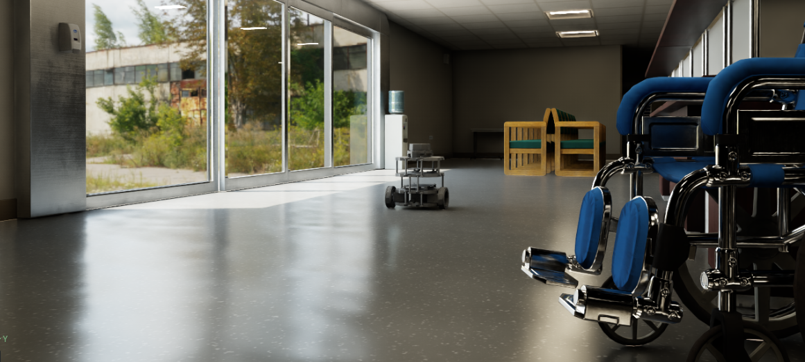

# Isaac Sim ROS 2 Autonomous Navigation

ROS 2 Nav2 workspace for a Clearpath Jackal-style robot simulated in Isaac Sim.
The navigation stack is designed around a 2D `sensor_msgs/LaserScan`, a
pre-existing occupancy-grid map, AMCL localization, and differential-drive
velocity commands.



## What is in this repository

```text
.
├── Jackal_in_TC4.usd                         # Isaac Sim scene
├── docs/images/isaac-sim-navigation.png      # Navigation screenshot
├── src/
│   ├── my_jackal_nav/
│   │   ├── config/
│   │   │   ├── add_diff_drive_isaac.py       # Isaac Sim /cmd_vel bridge
│   │   │   ├── ekf.yaml                      # Optional robot_localization config
│   │   │   ├── localization.rviz             # RViz map/localization view
│   │   │   └── nav2_params.yaml              # Nav2, AMCL, and costmaps
│   │   ├── launch/
│   │   │   ├── jackal_nav2.launch.py         # Main simulation bringup
│   │   │   ├── nav2_localization.launch.py   # Stand-alone map + AMCL option
│   │   │   └── view_map.launch.py             # Map server + RViz option
│   │   ├── maps/
│   │   │   ├── final_occ_map.{png,yaml}
│   │   │   └── hospitaljackal.{png,yaml}
│   │   ├── CMakeLists.txt
│   │   └── package.xml
│   └── tf/
│       └── frames_*.gv/.pdf                   # Recorded TF-tree snapshots
└── README.md
```

Generated `build/`, `install/`, and `log/` directories are local ROS 2
artifacts and should not be versioned. The repository `.gitignore` excludes
them.

## System logic

The intended data flow is:

```text
Isaac Sim
  ├── /scan (2D LaserScan, LiDAR frame)
  ├── /odom and /imu
  └── TF world -> odom
          │
          ▼
  static TF: base_link -> LiDAR frame
          │
          ▼
  AMCL: /scan + map + odometry
          │
          └── publishes map -> world
                  │
                  ▼
  Nav2 global costmap (map frame)
  Nav2 local costmap  (odom/world frame)
          │
          ▼
  NavFn global planner -> Regulated Pure Pursuit controller
          │
          ▼
  /cmd_vel
          │
          ▼
  Isaac Sim DifferentialController -> wheel joints
```

### 1. Isaac Sim command bridge

`config/add_diff_drive_isaac.py` is pasted into the Isaac Sim Script Editor.
It finds the first prim with `PhysicsArticulationRootAPI`, creates an
`/World/DiffDriveGraph`, subscribes to `/cmd_vel`, converts linear/angular
velocity into wheel velocities, and sends those velocities to the four Jackal
wheel joints. It uses a `0.098 m` wheel radius and `0.37 m` wheel separation.
The robot must be playing in Isaac Sim for the graph to execute.

### 2. LiDAR and transforms

`jackal_nav2.launch.py` publishes a static transform from `base_link` to
`sick_lms1xx_lidar_frame` using the configured mount offset. Isaac Sim is
expected to publish `/scan` with that frame ID. AMCL owns the global
`map -> world` transform; this avoids introducing a second publisher for that
edge when Isaac Sim publishes `world -> odom`.

### 3. Localization

AMCL consumes the map, `/scan`, and odometry to estimate the robot pose. The
configuration uses a likelihood-field laser model, 500--3000 particles,
beam skipping, and an initial pose. `tf_broadcast: true` makes AMCL publish
the global localization transform.

### 4. Costmaps

The global costmap combines the static occupancy map, live LiDAR obstacles,
and inflation. The local costmap is a rolling `3 m x 3 m` window in the
odometry/world frame. Both costmaps use `/scan` for marking and ray-tracing
obstacles and assume a `0.22 m` robot radius.

### 5. Planning and control

NavFn produces a grid-based global path. Regulated Pure Pursuit follows that
path, scales speed around obstacles and tight turns, rotates toward the path
when necessary, and publishes `/cmd_vel`. The controller is configured for a
maximum desired linear speed of `1.0 m/s`, a `0.25 m` positional goal
tolerance, and a `0.25 rad` heading tolerance.

### 6. Lifecycle and visualization

Nav2's bringup launch starts the map server, AMCL, planner, controller,
behavior, BT navigator, and lifecycle manager. RViz starts five seconds later
with the Nav2 default view. `localization.rviz` is an alternate RViz setup
that displays the map, TF, LaserScan, and robot model.

## Build

Use a ROS 2 installation with Nav2, RViz2, `tf2_ros`, and the Isaac Sim ROS 2
bridge available:

```bash
cd ~/jackal_ws
source /opt/ros/$ROS_DISTRO/setup.bash
colcon build --symlink-install
source install/setup.bash
```

## Run the main simulation bringup

1. Open `Jackal_in_TC4.usd` in Isaac Sim.
2. Run `src/my_jackal_nav/config/add_diff_drive_isaac.py` in the Script Editor.
3. Press **Play** in Isaac Sim.
4. In a sourced ROS 2 terminal, run:

```bash
ros2 launch my_jackal_nav jackal_nav2.launch.py
```

Set or confirm the initial pose in RViz, then use **Nav2 Goal** to send a
destination. Nav2 should plan around the static map and live 2D LiDAR
obstacles, and the controller should drive the simulated wheel joints.

## Alternate launch files

| Launch file | Purpose | Important difference |
| --- | --- | --- |
| `jackal_nav2.launch.py` | Full simulation navigation | Uses `final_occ_map.yaml`, `nav2_params.yaml`, `world` odometry frame, and `sick_lms1xx_lidar_frame`. |
| `nav2_localization.launch.py` | Stand-alone localization | Uses `hospitaljackal.yaml`, `odom`, and a LiDAR frame named `Lidar`; it does not start the full Nav2 planner/controller. |
| `view_map.launch.py` | Map visualization | Starts only a map server, lifecycle manager, and RViz. |

## Review findings and integration notes

The source was checked file by file. These items should be resolved before
calling the workspace production-ready:

1. **Two localization conventions:** the main launch uses `world` and
   `sick_lms1xx_lidar_frame`; the stand-alone localization launch uses `odom`
   and `Lidar`. Use one convention consistently with the Isaac Sim scene.
2. **EKF is not launched:** `config/ekf.yaml` configures
   `robot_localization`, but no launch file starts `ekf_node`. It is currently
   documentation/configuration only.
3. **Package dependencies:** `package.xml` should be expanded if the optional
   EKF is enabled, and should declare every runtime Nav2/plugin dependency
   required by the target ROS 2 distribution.
4. **Map selection:** `final_occ_map` is the map used by the main bringup;
   `hospitaljackal` is used by the alternate localization/view launch files.
   Confirm that the selected map matches the Isaac Sim environment.
5. **TF snapshots:** the files in `src/tf` are recorded graphs for debugging,
   not live TF publishers.

All launch-time file paths are now derived from the installed package share
directory, and the main map is supplied through the Nav2 launch argument.
The workspace can therefore be copied to a different machine or directory
without editing source paths.

These are documented rather than silently changed so the original simulation
behavior remains visible. The main launch path is the recommended starting
point for the current Isaac Sim scene.

## License and ownership

The package currently contains placeholder maintainer and license metadata in
`package.xml`. Add the actual project owner and license before publishing a
production or redistributed version.
